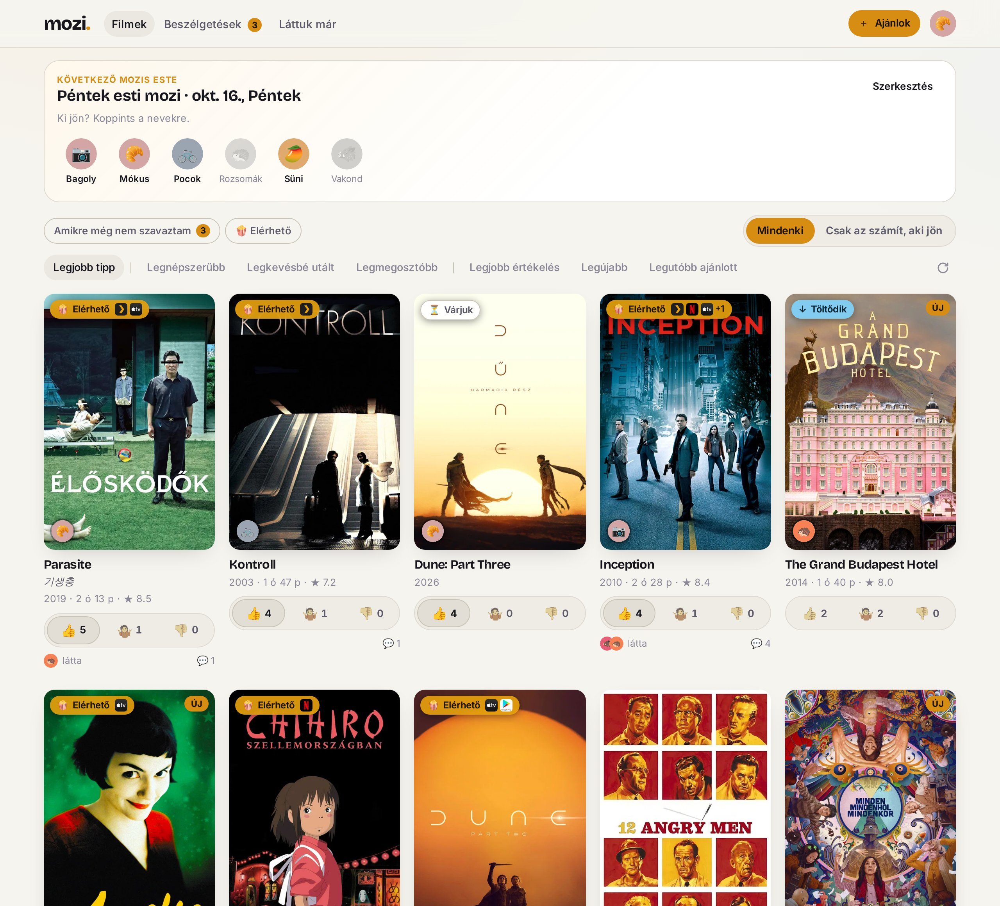
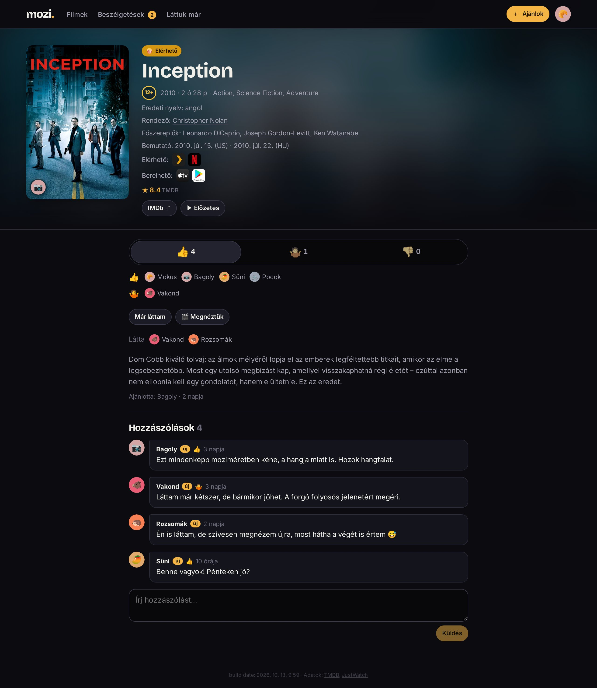

# mozi

A small private web app for a group of friends to collect movie recommendations,
vote on them (👍 / 🤷 / 👎) and pick what to watch at the next movie night.
The app is in Hungarian.

SvelteKit + SQLite, one container. Sign-in with Google, membership by invite link.
Shows whether a movie is already in the owner's Plex / Radarr.





## Development

```sh
cp .env.example .env      # DEV_LOGIN=1 enables /dev/login?as=<name>
npm ci --ignore-scripts
npm run dev
```

- `npm run check` · `npx vitest run` · `npm run test:e2e` · `npm run lint`
- Schema changes: edit `src/lib/server/db/schema.ts`, then `npm run db:generate`.
  Migrations run automatically at startup.
- README screenshots: `node scripts/readme-screenshots.ts` (throwaway database, made-up members).

## Deployment

`compose.yaml` builds the image and runs it behind a reverse proxy on an existing
Docker network. The proxy must pass `X-Forwarded-Host`, `X-Forwarded-Proto` and
`CF-Connecting-IP`. All deployment settings and credentials come from the
environment (see `.env.example`), none are in this repo. The Docker build runs the
typecheck and unit tests, so a failing commit never produces an image.
